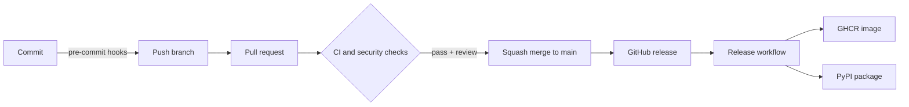
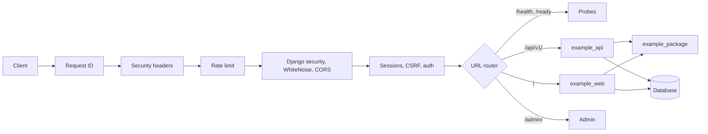

# Architecture

How the pieces of this template fit together. For day-to-day commands, see [development](development.md). For one-time repository settings, see [repository setup](repo-setup.md).

## Overview

A change moves through three layers of checks before it reaches `main`, and a release moves through one more before it reaches PyPI or GHCR.



## Layers

| Layer | What runs | Where |
| --- | --- | --- |
| Local | gitleaks, file hygiene, markdownlint, Ruff, `uv lock` check, mypy, Sweepito scan and cleanup | pre-commit hooks |
| Pull request | `ci` (lint and deployment checks, unit tests on Python 3.11 to 3.15 on Ubuntu plus 3.11 on Windows and macOS, PostgreSQL and MySQL runs, WSGI and ASGI integration tests, container smoke tests, build), dependency review, CodeQL | GitHub Actions |
| Repository | Branch ruleset, secret scanning with push protection, Dependabot alerts and updates | GitHub settings |
| Release | Version check, then optionally a Docker image to GHCR and a package to PyPI | `release.yml` |

## Source layout

```text
src/example_package/   typed library: all the logic, no web code
src/example_project/   Django project: settings, URL routes, WSGI/ASGI entry points, CLI
src/example_core/      Django app: models, admin, health probes, middleware
src/example_api/       optional REST API (Django REST Framework)
src/example_web/       optional server-rendered UI (templates and HTMX)
tests/                 pytest-django unit tests with coverage (80% minimum)
tests/integration/     tests marked `integration`: skipped by default and in pre-commit, run in CI
pyproject.toml         metadata, dependencies, optional database drivers and tool configuration
uv.lock                locked dependency set, checked by CI with --locked
docs/openapi.json      the API contract, generated and checked in CI
```

The version lives in one place, `__version__` in `example_package`, and Hatchling reads it at build time. The release workflow compares it with the release tag.

## Request flow



- `example_api` and `example_web` stay thin: validate input, call `example_package` or the ORM, and return a serializer or template. Business logic lives in `example_package`, which knows nothing about HTTP.
- Optional features register their routes only when enabled (`build_urlpatterns` in `example_project/urls.py`), so a disabled feature answers `404`.
- Every API error becomes an `application/problem+json` response, and unexpected errors never expose details.
- The database is chosen by `DATABASE_URL`. The same code runs on SQLite, PostgreSQL, MySQL and other Django backends.
- The same code runs under gunicorn (WSGI) and uvicorn (ASGI), started with `example-serve` or any other server pointed at `example_project.wsgi` or `example_project.asgi`.

## Workflows

| Workflow | Trigger | Purpose |
| --- | --- | --- |
| `ci.yml` | Pull request, push to `main` | Runs `lint`, `test`, `postgres`, `mysql`, `integration`, `docker` and `build`. A final `ci` job gates on all of them and is the only check the ruleset requires. |
| `security.yml` | Pull request, push to `main`, weekly | Runs Semgrep, Hadolint and a Trivy image scan, and uploads results to the Security tab. Not part of the required check. |
| `api-compat.yml` | Pull requests that change `docs/openapi.json` | Fails when the OpenAPI change would break existing callers (oasdiff). Not part of the required check. |
| `dependency-review.yml` | Pull request | Blocks pull requests that add vulnerable dependencies. |
| `audit.yml` | Weekly, manual, and pull requests that change `uv.lock` | Runs `pip-audit` on the locked dependencies, including the database drivers. |
| `release.yml` | GitHub release published | Checks the tag matches the version, then publishes the Docker image to GHCR and the package to PyPI. Each target runs only if its `PUBLISH_GHCR` or `PUBLISH_PYPI` repository variable is `true`; both start `false`. |
| `init.yml` | Manual | One-time placeholder replacement in a repo created from the template. Skipped in the template itself. |

CodeQL runs through the default setup of GitHub rather than a workflow file.

## Branch governance

The `main` ruleset in `.github/rulesets/main.json` is applied by `scripts/apply_repo_settings.py`. It requires:

- a pull request with a code owner review and resolved conversations, squash merge only
- the `ci` and `dependency-review` checks, with the branch up to date
- CodeQL results
- no deletion and no force push

Repository admins can bypass through a pull request so a solo maintainer is not locked out.

## Release flow

1. Bump `__version__` and update `CHANGELOG.md` in a pull request.
2. After merge, publish a GitHub release tagged `v<version>`.
3. `release.yml` skips every target whose repository variable is not `true`.
4. **GHCR:** builds the image, pushes it tagged with the version, `major.minor` and `latest`, and attaches a build provenance attestation.
5. **PyPI:** builds the sdist and wheel in one job, then a second job in the `pypi` environment publishes them using OpenID Connect. No API token is stored, and only the publish job gets the `id-token` permission.

## Template lifecycle

GitHub copies files, not settings. A new repo therefore needs three steps: run **Init** to replace the template owner and name, rename the example packages, and run the settings script to apply protections, the ruleset and the release switches.
